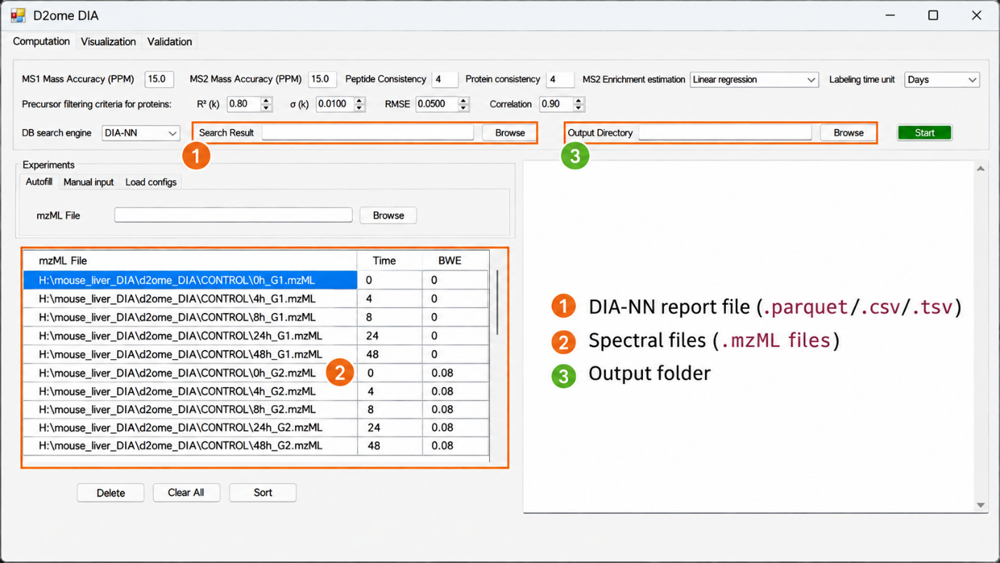
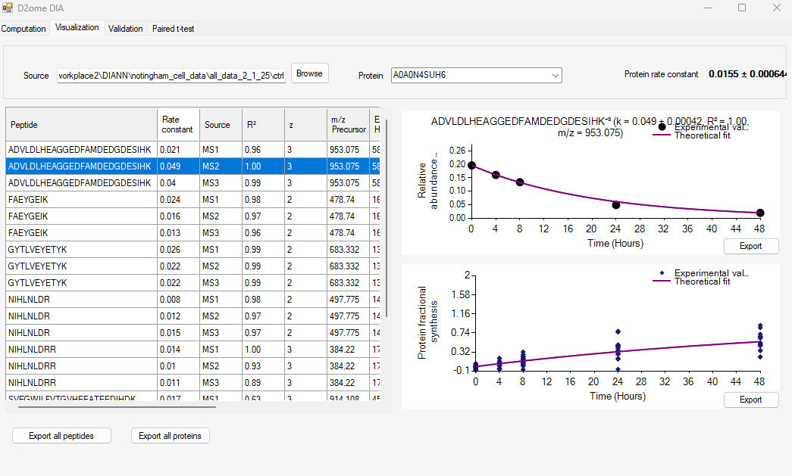
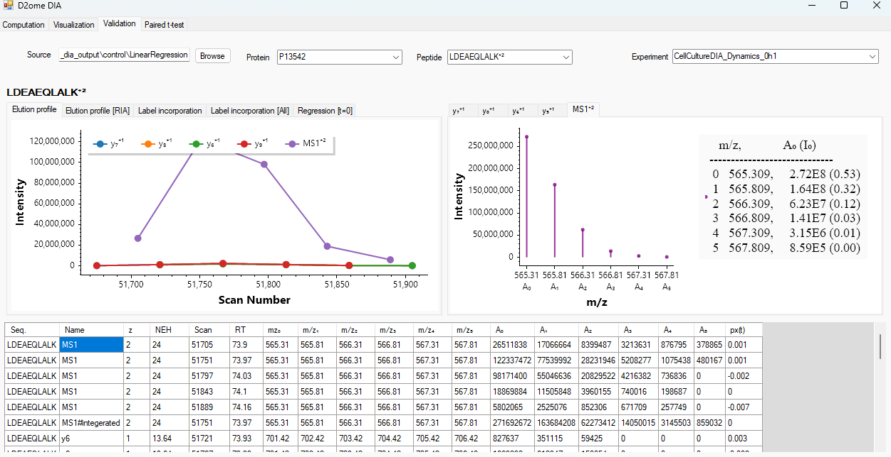

# D2ome-DIA software:

## DIA quantification and turnover rate estimation workflow

d2ome-DIA is a stand-alone software tool designed to compute turnover rates of peptides/proteins from metabolic deuterated water-labeling combined data-independent acquisition LC-MS experiments. It uses LC-MS spectral files (obtained from metabolically deuterated water labeled samples) in mzML format1,2 together with database search results (from DIA-NN5) to quantify label incorporations for precursor ions from MS1 spectra and fragment ions from MS2 spectra. Quantification includes the monoisotope and the first five heavy mass isotopomers. For precursor and fragment ion quantification, a monoisotopic signal is used only when the corresponding first heavy mass isotopomer is also detected in the same mass spectrum. It then computes peptide turnover rates and provides a graphical user interface (GUI) for visualizing quality of fitting of theoretical exponential depletion (of the monoisotopic relative isotope abundance, RIA) to the experimental data. It also includes a feature for visual inspection of MS1 and MS2 scans used in the quantification.

## Software outputs

The software generates two primary types of results: mass isotopomer quantifications and turnover rate estimates. For each quantified protein, a pair of csv files is generated using its protein ID as the filename prefix: “ProteinID.Quant.csv” and “ProteinID.RateConst.csv”. The “ProteinID.Quant.csv” file contains the mass isotopomer intensities of the protein’s constituent peptides, quantified from MS1 spectra in each mzML file acquired at different labeling time points.

Turnover rate results include peptide and protein degradation rates, 95% confidence intervals, and goodness-of-fit measures for the theoretical curve fits. The “ProteinID.RateConst.csv” file contains turnover rates obtained from MS1 and MS2 spectra for the constituent peptides of the protein; “Analyzed_Proteins_and_Their_Rates.csv” summarizes turnover rates for all identified proteins.

The software also stores isotope profiles and their integrated values for precursor ions from MS1 scans and fragment ions from MS2 scans in intermediate Parquet files. These profiles cover the peptides and fragment ions included in the DIA-NN search results and support examination of elution profiles, label enrichment, and quantification.

## d2ome-DIA software execution

The following procedure describes how to run the d2ome-DIA.

1. Download the Windows release/build from https://github.com/rgsadygov/d2ome-DIA and extract the complete application folder. Keep the graphical user interface (GUI), executable and dll files in the same folder.

2. Prepare the database search report file as described above. For a DIA-NN parquet file use the “--export-quant” option. At the time of publication, d2ome-DIA is compatible with the output from DIA-NN version v1.9.3. I

3. On the computation tab, select the search engine and browse to the csv, tsv, or parquet file to be used in the analysis. Select the mzML folder using Autofill/Browse under Experiments and verify that the mzML file names match the run identifiers in the report, as shown in the screen shot below:

    

4. Enter each labeling duration in Time and its body-water enrichment (BWE) into the corresponding columns. BWE must be specified as a fraction (e.g., 5% = 0.05). Review the labeling-time unit (days or hours), MS1 and MS2 mass accuracies, peptide/protein consistency, and enrichment-estimation method.

5. Select an empty, writable output folder and click Start. d2ome-DIA writes files.txt and quant.state files into the output folder and launches the quantification process. Parquet report file is first converted to tsv format and then passed to d2ome.

6. Examine the resulting quantification and turnover-rate files the Visualization tab to inspect the turnover fits and the underlying MS1/MS2 data. Shown below is an example of the Visualization.

    

7. The screenshot of the validation page of the d2ome-DIA GUI is provided below. It shows the quantification (monoisotopic relative abundance, RA) results from MS1 and tandem mass spectra (MS/MS), absolute abundance of the monoisotopic peak, and retention times, mass-to-charge ratios of a peptide from liquid-chromatography mass spectrometry experiments at all labeling durations.

    

8. The Validation page has five tabs. Shown is the “Elution Profile” tab, which shows the elution profiles of fragment ions and the precursor ion of the peptide.

9. The “Elution Profiles (RIA)” provides the elution profile for monoisotopic relative isotope abundances for precursor and fragment ions.

10. The other tabs on the Validation page allow the visualizations of other quantitative information for label enrichment determination, such as monoisotopic RIA elution profile, and label incorporation.

## References

(1) Gilski, M. J.; Sadygov, R. G. Comparison of Programmatic Approaches for Efficient Accessing to mzML Files. J. Data Mining. Genomics Proteomics 2011, 2 (1).

(2) Martens, L.; Chambers, M.; Sturm, M.; Kessner, D.; Levander, F.; Shofstahl, J.; Tang, W. H.; Rompp, A.; Neumann, S.; Pizarro, A. D.; et al. mzML--a community standard for mass spectrometry data. Mol Cell Proteomics 2011, 10 (1), R110 000133. DOI: 10.1074/mcp.R110.000133.

(3) Chambers, M. C.; Maclean, B.; Burke, R.; Amodei, D.; Ruderman, D. L.; Neumann, S.; Gatto, L.; Fischer, B.; Pratt, B.; Egertson, J.; et al. A cross-platform toolkit for mass spectrometry and proteomics. Nat Biotechnol 2012, 30 (10), 918-920. DOI: 10.1038/nbt.2377  From NLM Medline.

(4) Perkins, D. N.; Pappin, D. J.; Creasy, D. M.; Cottrell, J. S. Probability-based protein identification by searching sequence databases using mass spectrometry data. Electrophoresis 1999, 20 (18), 3551-3567.

(5) Demichev, V.; Messner, C. B.; Vernardis, S. I.; Lilley, K. S.; Ralser, M. DIA-NN: neural networks and interference correction enable deep proteome coverage in high throughput. Nat Methods 2020, 17 (1), 41-44. DOI: 10.1038/s41592-019-0638-x  From NLM Medline.

(6) Cambridge, S. B.; Gnad, F.; Nguyen, C.; Bermejo, J. L.; Kruger, M.; Mann, M. Systems-wide proteomic analysis in mammalian cells reveals conserved, functional protein turnover. J Proteome Res 2011, 10 (12), 5275-5284. DOI: 10.1021/pr101183k.
